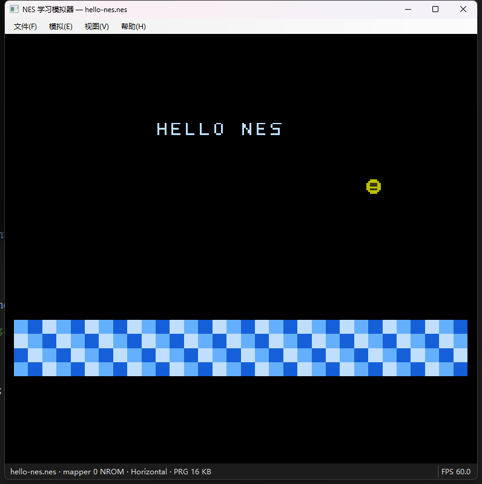

# NES 学习模拟器（.NET / C#）

一个**从零实现、为学习而写**的 NES（Famicom / Nintendo Entertainment System）模拟器。
目标不是做商业级兼容模拟器，而是把“一台游戏机是怎样被设计出来、游戏又是怎样跑起来的”
拆成可以阅读、可以修改、可以验证的 C# 代码，并配上一套系统性的中文资料。

> 核心库不依赖任何第三方包。桌面端只使用 .NET 自带的 WinForms 和 Windows `winmm` 音频 API。



## 已经实现的内容

| 模块 | 实现 |
|---|---|
| CPU | Ricoh 2A03（MOS 6502 变体）全部 256 个操作码，含非官方指令、NMI/IRQ/BRK/复位、页跨界周期、`JMP ($xxFF)` bug |
| PPU | 2C02，256×240；pattern table / nametable / 属性表 / 调色板；背景细滚动；精灵（8×8、8×16、翻转、优先级）；sprite 0 hit；sprite overflow；vblank/NMI；名称表镜像；4 KB 四屏 VRAM |
| APU | 方波 1/2、三角波、噪声、DMC；包络、长度计数器、扫频、帧序列器、混音；44100 Hz 单声道 PCM |
| 卡带 | iNES 1.0 与常见 NES 2.0 头；mapper 0 / 1 / 2 / 3 / 4；CHR-RAM、电池存档；MMC3 扫描线 IRQ |
| 输入 | 标准手柄 1/2 的选通与串行读取；键盘映射 |
| 主机 | CPU/PPU/APU 时钟同步，OAM DMA，总线镜像，NMI/IRQ 汇总，单帧步进 |
| 前端 | WinForms 桌面窗口、最近邻缩放、全屏、暂停、复位、截图、声音；无头 CLI + PNG 截图 |
| 学习配套 | 自制演示 ROM 及其汇编器源码、自动化测试、nestest 对拍、10 篇中文原理/资料文档 |

## 快速开始

### 环境

- Windows 10/11
- .NET SDK 10 或更新版本（项目目标框架为 `net10.0` / `net10.0-windows`）
- 桌面端需要 Windows Desktop Runtime；命令行和测试只需要 .NET Runtime

```powershell
# 构建全部项目
dotnet build NesEmulator.slnx

# 直接启动桌面端，并自动加载自制演示 ROM
dotnet run --project src/NesEmulator.Desktop -- samples/hello-nes.nes
```

如果不带参数，启动后使用 **文件 → 打开 ROM** 选择任意 `.nes` 文件。

### 无头运行与截图

```powershell
dotnet run --project src/NesEmulator.Cli -- samples/hello-nes.nes --frames 120 --screenshot artifacts/hello-nes.png
```

CLI 会打印卡带信息、实际运行帧率、CPU/PPU/APU 状态，并可把最后一帧保存为 PNG。

### 重新生成演示 ROM

```powershell
dotnet run --project tools/HelloNes.Builder
```

该工具用 C# 里的迷你 6502 汇编器生成 `samples/hello-nes.nes`，源码在
[`tools/HelloNes.Builder/Program.cs`](tools/HelloNes.Builder/Program.cs)，适合配合
[`docs/09-NES游戏开发流程.md`](docs/09-NES游戏开发流程.md) 阅读。

### 运行测试

```powershell
dotnet run --project tests/NesEmulator.Tests
```

当前结果：

- **nestest 全部 8,991 条指令的寄存器与周期全部一致**
- 卡带/mapper、手柄、总线镜像、APU、PPU 与整机测试共 13 项通过
- 加上 nestest 共 14 项；测试资料未打包时，nestest 一项会显示 `[SKIP]`

`nestest.nes` 和日志受版权/分发方式影响，没有默认打包。可运行
`powershell -ExecutionPolicy Bypass -File scripts/fetch-nestest.ps1`（或
`scripts\fetch-nestest.cmd`）下载后再执行测试，详见
[`docs/07-测试与验证.md`](docs/07-测试与验证.md)。

## 操作方式

| 按键 | 功能 |
|---|---|
| 方向键 | 十字键 |
| Z / X | A / B |
| Enter | Start |
| Shift | Select |
| P | 暂停 / 继续 |
| F2 | 复位主机 |
| F10 | 暂停时单帧步进 |
| F12 | 保存当前画面为 PNG |
| F11 | 全屏切换 |
| Ctrl+O | 打开 ROM |

## 项目结构

```text
NES/
├─ NesEmulator.slnx
├─ src/
│  ├─ NesEmulator.Core/           # 与 UI 无关的模拟器核心
│  │  ├─ Cpu/                     # 6502 CPU、256 项操作码表
│  │  ├─ Ppu/                     # 2C02 PPU、调色板、帧缓冲
│  │  ├─ Apu/                     # 2A03 APU、五个声道、音频缓冲
│  │  ├─ Cartridges/              # iNES 解析、mapper 0-4
│  │  ├─ Bus/                     # CPU 总线与地址解复用
│  │  ├─ Input/                   # 标准手柄
│  │  └─ Emulation/               # NesConsole 整机同步
│  ├─ NesEmulator.Cli/            # 无头运行器 + PNG 写出
│  └─ NesEmulator.Desktop/        # WinForms 桌面端 + waveOut 音频
├─ tests/NesEmulator.Tests/       # 无第三方依赖的测试运行器
├─ tools/HelloNes.Builder/        # 迷你汇编器与演示 ROM 生成器
├─ samples/hello-nes.nes          # 本项目自制 ROM（可自由分发）
├─ scripts/fetch-nestest.ps1      # 下载本地测试资料
├─ docs/                          # 中文教程、原理、资料
└─ artifacts/                     # 运行产物（截图等，不提交）
```

## 文档索引

建议按顺序阅读：

1. [NES 架构总览：一台游戏机如何协同工作](docs/01-NES架构总览.md)
2. [6502 CPU：寄存器、寻址、周期与中断](docs/02-6502-CPU.md)
3. [2C02 PPU：图块、滚动、精灵与 NMI](docs/03-2C02-PPU.md)
4. [2A03 APU：五个声道与音频输出](docs/04-2A03-APU.md)
5. [卡带与 Mapper：iNES、换页与扫描线 IRQ](docs/05-卡带与Mapper.md)
6. [源码导读与扩展指南](docs/06-源码导读与扩展.md)
7. [测试与验证：nestest、测试 ROM、截图](docs/07-测试与验证.md)
8. [学习路线与外部资料](docs/08-学习路线与资料.md)
9. [NES 游戏是怎样开发的：从零写一个演示 ROM](docs/09-NES游戏开发流程.md)
10. [已知限制、设计取舍与后续路线](docs/10-已知限制与后续路线.md)

## 兼容性说明

以下 ROM 曾在本机做过启动/画面验证（**不随仓库分发**）：

| ROM | Mapper | 结果 |
|---|---|---|
| `pong1k.nes` | 0 NROM，CHR-RAM | 正常显示、可运行 |
| `robotfindskitten.nes` | 0 NROM，32 KB PRG | 正常显示标题/文本 |
| `Nova the Squirrel` | 1 MMC1，256 KB PRG，CHR-RAM | 正常显示标题画面 |
| `Twin Dragons` | 2 UxROM，256 KB PRG | 正常显示标题/菜单 |
| `Miedow`、`Robo-Ninja Climb` | 3 CNROM | 正常显示标题画面 |
| `Indivisible on NES` | 4 MMC3，128 KB PRG/CHR | 正常显示标题画面 |
| `The Legends of Owlia`、`Nomolos` | 2 UxROM，512 KB/UNROM-512 | 标题画面异常；该板接近 mapper 30，需要单独实现 UNROM-512 变体 |

本项目**没有**用商业 ROM 做兼容性承诺，也不会分发商业 ROM。不同游戏对 PPU dot 级时序、
DMC DMA、mapper 变体的要求不同；当前实现更适合学习、运行多数 NROM/MMC1/UxROM/CNROM/MMC3
游戏和自制程序。具体边界见 [已知限制](docs/10-已知限制与后续路线.md)。

## 授权与法律

- 本项目代码、文档和 `samples/hello-nes.nes` 采用 MIT 许可证，见 [LICENSE](LICENSE)。
- **不包含任何任天堂商业 ROM、BIOS 或图形资源**。
- `nestest`、blargg 测试 ROM 等第三方测试材料有各自的分发条件，请从官方仓库获取并遵守其许可。
- NES、Famicom 是任天堂的商标；本项目与任天堂无关联，仅用于技术学习。
