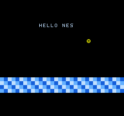

# 07 · 测试与验证：nestest、测试 ROM、截图

> 模拟器开发最怕“看起来能跑”。这一篇给出可重复的验证方法，以及本项目当前的实测结果。

## 1. 一条命令跑全部自检

```powershell
dotnet run --project tests/NesEmulator.Tests
```

测试项目没有使用 xUnit/NUnit，而是一个自己写的极简运行器，目的是：

- 零 NuGet 依赖，`dotnet run` 就能跑；
- 输出适合直接阅读；
- 方便在离线环境验证。

当前结果（本机）：

```text
■ CPU：nestest 逐指令对拍
  nestest：共 8991 条指令，失败 0 条。
  [PASS] nestest 全 8991 条指令（含周期）

■ iNES 解析与卡带
  [PASS] 16 KB NROM 在 $C000 正确镜像
  [PASS] MMC1 串行移位寄存器切换 PRG bank
  [PASS] UxROM 固定最后一块 PRG bank
  [PASS] CNROM 切换 CHR bank
  [PASS] MMC3 切换 PRG bank 并改写镜像
  [PASS] MMC3 的 CHR 模式与扫描线 IRQ

■ 手柄与总线
  [PASS] 标准手柄选通/串行位顺序
  [PASS] CPU RAM 镜像与 PPU 寄存器镜像

■ APU
  [PASS] 方波声道产生非零 PCM 样本
  [PASS] APU 帧 IRQ 可读并应答

■ PPU 与整机
  [PASS] 名称表镜像与调色板镜像
  [PASS] 背景与 sprite 0 hit
  [PASS] 自制 ROM 运行、NMI、精灵与画面

测试汇总：通过 14，失败 0，跳过 0。
```

如果 `.testdata/nestest.nes` 不存在，nestest 一项会显示 `[SKIP]`，其余 13 项仍会运行并通过。
因此“14”是包含 nestest 的数量，“13”是无需外部测试数据的核心测试数量。

## 2. nestest 对拍

### 2.1 它是什么

`nestest` 是 6502 社区最经典的 CPU 测试 ROM。它从 `$C000` 开始执行大量指令，
并把每条指令执行前的 PC、A、X、Y、P、SP、PPU 位置和累计周期写入日志。

官方日志形如：

```text
C000  4C F5 C5  JMP $C5F5     A:00 X:00 Y:00 P:24 SP:FD PPU: 0, 21 CYC:7
C5F5  A2 00     LDX #$00      A:00 X:00 Y:00 P:24 SP:FD PPU: 0, 30 CYC:10
```

注意：`CYC` 是**执行本条指令之前**的累计周期。下一条日志的 `CYC` 才验证上一条
指令消耗了多少周期。测试程序当前按这个语义逐行比较。

### 2.2 下载

```powershell
powershell -ExecutionPolicy Bypass -File .\scripts\fetch-nestest.ps1
```

如果 PowerShell 执行策略禁止运行脚本，也可以直接双击/运行
`scripts\fetch-nestest.cmd`（只对这一次调用使用 Bypass，不修改系统全局设置）。

或手动执行：

```powershell
New-Item -ItemType Directory -Force .testdata | Out-Null
Invoke-WebRequest `
  -Uri 'https://raw.githubusercontent.com/christopherpow/nes-test-roms/master/other/nestest.nes' `
  -OutFile '.testdata/nestest.nes'
Invoke-WebRequest `
  -Uri 'https://raw.githubusercontent.com/christopherpow/nes-test-roms/master/other/nestest.log' `
  -OutFile '.testdata/nestest.log'
```

来源：[christopherpow/nes-test-roms](https://github.com/christopherpow/nes-test-roms)。

这些文件不在仓库中分发，请遵守上游仓库的版权/许可。

### 2.3 实现方式

[`NestestHarness.cs`](../tests/NesEmulator.Tests/NestestHarness.cs)：

1. 用 `InesRomLoader` 读取 ROM；
2. 把 16 KB PRG 映射到 `$8000-$FFFF`；
3. 使用 64 KB 线性内存假总线；
4. 把 CPU 初始状态设为日志第一行；
5. 对每一行比较 PC/A/X/Y/P/SP/CYC，然后执行；
6. 任何不一致打印行号、期望值、实际值。

它覆盖：

- 所有官方指令；
- 非官方指令区段；
- 页跨界周期；
- 分支周期；
- 栈操作；
- 标志位；
- 累计周期。

### 2.4 为什么它能抓出很多 bug

CPU 的“功能对”不等于“周期对”。nestest 会同时检查：

- 指令语义；
- 寻址边界（零页回绕、页跨界）；
- 周期计数；
- 状态寄存器；
- 栈指针。

本项目的 CPU 在首次对拍时就暴露过 `TAX/TAY` 写法错误和日志语义理解错误，
修正后 8,991 条全部通过。

## 3. 自制演示 ROM 测试

[`CoreTests.DemoToml`](../tests/NesEmulator.Tests/CoreTests.cs) 会：

- 加载 `samples/hello-nes.nes`；
- 运行 60 帧；
- 检查 PPU 帧计数；
- 检查 NMI 计数器（零页 `$00`）；
- 检查精灵 X 坐标（`$0203`）被 NMI 移动；
- 统计标题区域和彩色条区域的非黑像素。

这同时覆盖：

- CPU 复位/循环；
- PPU 调色板、名称表、pattern table；
- vblank/NMI；
- OAM DMA；
- 逐帧动画；
- 帧缓冲输出。

## 4. 其他自动化测试

| 测试 | 验证点 |
|---|---|
| NROM 镜像 | 16 KB PRG 在 `$8000/$C000` 重复 |
| MMC1 | 5 位串行写入、PRG 模式 3、固定最后 bank |
| UxROM | bank 切换、固定最后 bank |
| CNROM | CHR bank 切换 |
| MMC3 | R6 映射、`$A000` 镜像、CHR 模式、扫描线 IRQ |
| 手柄 | 选通、8 位顺序、第 9 位补 1 |
| 总线镜像 | CPU RAM 镜像、`$2007` 读缓冲 |
| PPU 镜像 | 名称表 Horizontal/Vertical、调色板 `$3F10 -> $3F00` |
| PPU 精灵 | 背景与 sprite 0 重叠时置 hit |
| APU 方波 | 产生非零 PCM |
| APU 帧 IRQ | 29829 周期置位、读 `$4015` 清除 |

## 5. 无头 ROM 验证

CLI 可以对任意 ROM 做冒烟测试：

```powershell
dotnet run --project src/NesEmulator.Cli -- .testdata/pong1k.nes --frames 180 --screenshot artifacts/pong.png
```

它会打印：

- 文件头/mapper/尺寸；
- 实际无头 FPS；
- 运行后的 PC、累计周期、Jammed；
- PPU 帧数、vblank；
- APU 可读样本数；
- 截图路径。

### 5.1 本机实测（ROM 不随仓库分发）

| ROM | Mapper | 结果 |
|---|---|---|
| `pong1k.nes` | 0 NROM，CHR-RAM | 正常显示球拍/球/中线 |
| `robotfindskitten.nes` | 0 NROM，32 KB PRG | 正常显示标题和说明文字 |
| `Nova the Squirrel` | 1 MMC1，256 KB PRG，CHR-RAM | 正常显示标题画面 |
| `Twin Dragons` | 2 UxROM，256 KB PRG | 正常显示标题/菜单 |
| `Miedow`、`Robo-Ninja Climb` | 3 CNROM | 正常显示标题画面 |
| `Indivisible on NES` | 4 MMC3，128 KB PRG/CHR | 正常显示标题画面 |
| `The Legends of Owlia`、`Nomolos` | 2 UxROM，512 KB/UNROM-512 | 标题画面异常（接近 mapper 30，需要单独实现） |

这些 ROM 只用于本地验证，仓库不包含它们。

### 5.2 截图

桌面端：`F12` 保存 PNG。
CLI：`--screenshot path.png`。
PNG 写出器是
[`PngWriter.cs`](../src/NesEmulator.Cli/PngWriter.cs)，
不依赖 `System.Drawing`。



这张图是 120 帧时由 CLI 直接写出的 256×240 PNG，不经过桌面窗口或 GDI 缩放。

## 6. 更严格的测试 ROM

以下测试 ROM 适合进一步打磨精度（从 [nes-test-roms](https://github.com/christopherpow/nes-test-roms) 获取）：

- `instr_test-v5`：CPU 指令；
- `ppu_vbl_nmi`：vblank/NMI 的 dot 级时序；
- `sprite_hit_tests`：sprite 0 hit；
- `sprite_overflow_tests`：精灵溢出 bug；
- `blargg_ppu_tests_2005.09.15b`：调色板、滚动、VRAM；
- `apu_tests`、`dmc_tests`：APU 时序；
- `mmc3_test`：MMC3 bank/IRQ。

**预期**：当前实现会在需要 dot 级精度的测试上失败，例如：

- `ppu_vbl_nmi` 的精确读写竞争；
- `sprite_overflow_tests`（未模拟硬件 bug）；
- 依赖 DMC DMA 停顿的测试；
- MMC3 A12 精确时序测试。

这不是“测试坏了”，而是当前设计取舍。通过它们需要按
[`10-已知限制与后续路线.md`](10-已知限制与后续路线.md) 的建议重构同步模型。

## 7. 手工验收清单

运行桌面端时建议检查：

- [ ] 打开 ROM 后标题栏显示文件名；
- [ ] 状态栏显示 mapper、镜像、PRG 大小；
- [ ] 画面比例 16:15，像素锐利；
- [ ] P 能暂停/继续；
- [ ] F2 复位后游戏回到标题；
- [ ] F10 单帧步进能推进画面；
- [ ] F12 截图文件可打开；
- [ ] F11 全屏/退出全屏；
- [ ] 方向键/Z/X/Enter/Shift 能操作游戏；
- [ ] 声音开启时无持续爆音/卡顿；
- [ ] 关闭窗口后 `.sav` 电池存档写入（仅电池卡带）。

## 8. 构建验证

```powershell
dotnet build NesEmulator.slnx -c Release
dotnet run --project tests/NesEmulator.Tests -c Release
```

当前解决方案在 Debug/Release 下均应 0 警告、0 错误（以本机 SDK 为准）。

## 9. 外部资料

- [NESdev: Emulator tests](https://www.nesdev.org/wiki/Emulator_tests)
- [christopherpow/nes-test-roms](https://github.com/christopherpow/nes-test-roms)
- [nestest 说明](https://www.nesdev.org/wiki/Emulator_tests#CPU_tests)
- [blargg 的 PPU/APU 测试](https://www.nesdev.org/wiki/Emulator_tests#PPU_tests)
